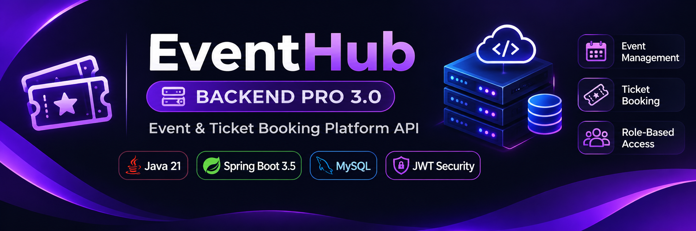

<div align="center">



</div>


<div align="center">

# EventHub Backend Pro 3.0

### Event & Ticket Booking Platform API

<p>
  
  
  
  
  
</p>

</div>

---

## About The Project

EventHub Backend Pro 3.0 is a production-style event and ticket booking platform backend inspired by popular event booking applications.

Built using Java 21, Spring Boot 3.5, MySQL, Spring Security and JWT authentication.


# EventHub Backend Pro 3.0

A production-style college/placement project backend inspired by large event and ticket booking platforms.
It is a **Spring Boot 3.5 + Java 21 + MySQL + Spring Security + JWT** Maven project and intentionally does **not use Lombok**, so Eclipse does not need Lombok installation or annotation processing.

## What is included

### Authentication & security
- Register/login with BCrypt password hashing
- JWT authentication
- USER / ORGANIZER / ADMIN roles
- Method-level role protection
- CORS for local React/Angular development
- Disabled-user protection

### Event catalogue
- Movie, Concert, Sports, Comedy, Theatre, College Event, Activity, Workshop, Conference and Other types
- Event creation by organizer/admin
- Organizer events enter `PENDING_APPROVAL`
- Admin can publish/cancel/complete events
- City/type/title search
- Pagination and start-time sorting
- Venue assignment
- Poster/banner URLs
- Language, genre and age rating

### Venue & seats
- Venue management
- Automatic seat generation
- Premium/regular seat categories
- Seat multipliers
- Seat availability endpoint
- Blocked seat status
- Event-specific booked-seat detection

### Booking
- Multi-seat booking
- Duplicate-seat validation
- Venue validation
- Event availability validation
- Tax calculation
- Coupon discount calculation
- Booking code generation
- QR payload generation
- Booking history
- Single booking lookup
- Cancellation/refund state

### Temporary seat locking
- 10-minute seat holds
- Hold ownership validation
- Expired hold cleanup every 60 seconds
- Prevents another user from taking an active hold
- Hold release endpoint

### Payments
- Demo payment transaction records
- Transaction ID generation
- Payment status
- Refund state on cancellation
- User payment lookup by booking

### Coupons
- Percentage coupon
- Flat coupon
- Minimum order amount
- Maximum discount
- Start/end date
- Usage limit
- Active/inactive state

### User features
- Profile view/update
- Favorites/wishlist
- Notifications
- Unread notification count
- Mark notification as read
- Reviews and ratings

### Admin
- Dashboard statistics
- User listing
- Change user role
- Enable/disable user
- Pending event listing
- Booking listing
- Coupon CRUD
- Venue CRUD
- Seat generation

## Default development admin
- Email: `admin@eventhub.com`
- Password: `Admin@123`

Change this before deployment.

## MySQL setup
You can create the database manually:

```sql
CREATE DATABASE eventhub;
```

Or leave the default JDBC URL as-is; `createDatabaseIfNotExist=true` is enabled.

Default configuration:
- Host: localhost
- Port: 3306
- Database: eventhub
- Username: root
- Password: root

If your MySQL password is different, edit `src/main/resources/application.properties`:

```properties
spring.datasource.password=YOUR_MYSQL_PASSWORD
```

## Eclipse import
1. Extract the ZIP.
2. Eclipse -> File -> Import.
3. Maven -> Existing Maven Projects.
4. Select the **EventHub-Backend-Pro** folder containing `pom.xml`.
5. Finish.
6. Right click project -> Maven -> Update Project.
7. Run `EventHubApplication.java` as Spring Boot App.

No Lombok plugin is required.

## Main API list

### Auth
- POST `/api/auth/register`
- POST `/api/auth/login`

### Public catalogue
- GET `/api/events/public`
- GET `/api/events/{id}`
- GET `/api/events/{id}/seats`
- GET `/api/events/{id}/reviews`
- GET `/api/venues/public`

### Organizer/Admin
- POST `/api/events`
- PATCH `/api/events/{id}/status`
- POST `/api/venues`
- POST `/api/venues/{id}/generate-seats`

### Booking
- POST `/api/bookings`
- GET `/api/bookings/mine`
- GET `/api/bookings/{code}`
- POST `/api/bookings/{code}/cancel`

### Seat holds
- POST `/api/seat-holds`
- GET `/api/seat-holds/mine`
- DELETE `/api/seat-holds/{id}`

### User
- GET `/api/me/profile`
- PATCH `/api/me/profile`
- GET `/api/me/favorites`
- GET `/api/me/notifications`
- GET `/api/me/notifications/unread`
- PATCH `/api/me/notifications/{id}/read`
- POST `/api/events/{id}/favorite`
- POST `/api/events/{id}/reviews`

### Payment
- GET `/api/payments/booking/{bookingId}`

### Admin
- GET `/api/admin/dashboard`
- GET `/api/admin/events/pending`
- GET `/api/admin/bookings`
- GET `/api/admin/users`
- PATCH `/api/admin/users/{id}/role?role=ORGANIZER`
- PATCH `/api/admin/users/{id}/enabled?enabled=true`
- POST `/api/admin/coupons`
- GET `/api/admin/coupons`
- DELETE `/api/admin/coupons/{id}`

## Example register request

```json
{
  "name": "Vicky",
  "email": "vicky@example.com",
  "password": "Password@123",
  "phone": "9876543210",
  "city": "Pune"
}
```

Login returns a JWT. Send it on protected requests:

```text
Authorization: Bearer YOUR_JWT_TOKEN
```

## Important production upgrades
This project is intentionally ready for frontend integration and college/placement demonstration. For a real commercial deployment, replace the demo payment flow with Razorpay/Stripe, use Redis for distributed seat locks, add a real QR/PDF ticket service, object storage for images, email/SMS providers, refresh-token rotation, rate limiting, audit logs, and centralized monitoring.


---

## ✨ Key Features

### 🔐 Authentication & Security
- Secure user registration and login
- JWT-based authentication
- BCrypt password encryption
- USER, ORGANIZER and ADMIN roles
- Role-based endpoint protection

### 🎭 Event Management
- Create and manage events
- Multiple event categories
- Event approval workflow
- Search by city, type and title
- Pagination and sorting

### 🎟️ Seat Management
- Automatic seat generation
- Premium and regular seats
- Real-time seat availability endpoint
- Temporary 10-minute seat locking
- Prevent duplicate seat booking

### 📋 Booking System
- Multi-seat booking
- Booking history
- Unique booking codes
- QR ticket payload generation
- Booking cancellation and refund status

### 💳 Payments & Coupons
- Demo payment transactions
- Payment status tracking
- Percentage and flat discounts
- Coupon expiry and usage limits

### 👤 User Features
- User profile management
- Favorites and wishlist
- Notifications
- Reviews and ratings

### 🛡️ Admin Dashboard
- Dashboard statistics
- User and role management
- Event approval
- Booking management
- Venue and coupon management
